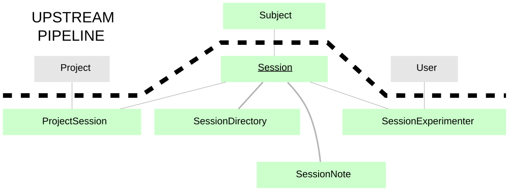

> ## ⚠️ This is the `datajoint-2.x` branch of a fork
>
> Unofficial fork of [`datajoint/element-session`](https://github.com/datajoint/element-session),
> ported to **DataJoint 2.x**. Not affiliated with DataJoint. See
> [why this branch exists](#why-this-branch-exists) at the bottom.

[](http://badge.fury.io/py/element-session)

# DataJoint Element - Session

DataJoint Element for Session Management. DataJoint Elements collectively standardize
and automate data collection and analysis for neuroscience experiments.  Each Element is
a modular pipeline for data storage and processing with corresponding database tables
that can be combined with other Elements to assemble a fully functional pipeline.

Installation and usage instructions can be found at the
[Element documentation](https://docs.datajoint.com/elements/element-session/).




---

## Why this branch exists

Upstream `element-session` was last committed on 2025-05-20 and targets DataJoint
`>=0.13`. DataJoint **2.0.0** shipped 2026-02-03 as a self-described complete
rewrite; the current release is 2.3.2. Because the element's dependency pin
admits 2.x, `pip install element-session` on a fresh environment today resolves
DataJoint 2.x and produces an installation in which the element cannot be
imported. No element has a 2.x branch and there is no open migration issue or
PR anywhere in the `datajoint` org.

This branch is a working port. It is layered in two commits so the reversible
part can be adopted independently:

| branch | changes | works on 0.14.x | works on 2.x |
|---|---|---|---|
| [`compat-fixes`](../../tree/compat-fixes) | 2 lines: `dj.schema`→`dj.Schema`, `boolean`→`bool`, `enum("x")`→`enum('x')` | **yes** | **yes** |
| `datajoint-2.x` (this branch) | `compat-fixes` **+ 2 × `longblob` → `<blob>`** | **no** | **yes** |

`compat-fixes` is offered upstream as a pull request. This branch is not, because
`<blob>` has no 0.14.x-compatible spelling — 0.14.9 rejects it with
`Support for Adapted Attribute types is disabled`.

### The `longblob` change is not cosmetic

Under DataJoint 2.x a `longblob` attribute is a **raw native column**. It
declares without error and the insert succeeds, but a numpy array written to it
comes back as `bytes`:

```
longblob   (as this element declares it)   -> returned type: bytes     round-trip OK: False
<blob>     (the 2.x codec)                 -> returned type: ndarray   round-trip OK: True
```

Nothing raises. There is no warning. Existing pipeline code fails later, far
from the cause, or silently computes on the wrong thing. See the corresponding
issue on the upstream repo for the full round-trip evidence.

### Using it

```
pip install git+https://github.com/akshay-jaggi/element-session.git@datajoint-2.x
```

Pin the commit rather than the branch name if you need reproducibility. Every
change on both branches was applied mechanically with regexes and reviewed; no
element behaviour was altered, only attribute-type spellings that 2.x renamed or
replaced.
